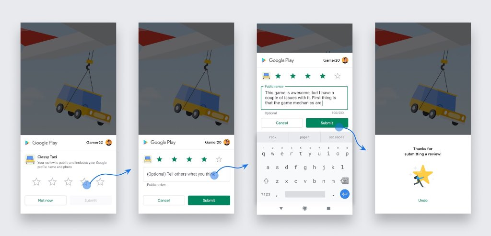
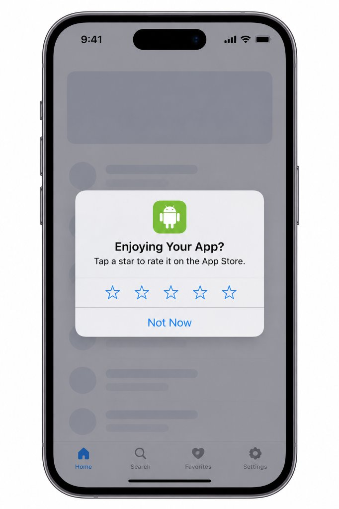

# react-native-in-app-store-review

Native in-app store rating and review prompts for React Native apps on Android and iOS.

Uses the **Google Play In-App Review API** on Android and **Apple StoreKit** (`AppStore.requestReview(in:)`) on iOS to present the official store review dialog — no custom UI.

---

## 📱 Preview

### Android (Google Play In-App Review Flow)
<p align="center">
  <a href="https://developer.android.com/guide/playcore/in-app-review" target="_blank" rel="noopener noreferrer">
    
  </a>
</p>

### iOS (Apple StoreKit Review Prompt)
<p align="center">
  
</p>

---

## Features

- 🤖 **Android** — Google Play In-App Review API (`com.google.android.play:review`)
- 🍎 **iOS** — Apple StoreKit `AppStore.requestReview(in:)` (iOS 16+ modern API, with fallback for iOS 14–15)
- ⚡ **TurboModule** — Built on the React Native New Architecture (Codegen / TurboModules)
- 📦 **Promise-based API** — Single async function with clean error handling
- 🔒 **No custom UI** — Uses the official native store dialogs

## Supported Platforms

| Platform | Minimum Version |
|----------|----------------|
| Android  | API 24 (Android 7.0) |
| iOS      | 14.0+ (with legacy fallback to 10.3+) |

## Requirements

- React Native **0.76+** (New Architecture / TurboModules)
- Node.js **≥ 18**
- For Android: Google Play Store installed on the device
- For iOS: Xcode 15+

---

## Installation

```sh
npm install react-native-in-app-store-review
```

### iOS — CocoaPods

After installing the npm package, install the native iOS pods:

```sh
cd ios && pod install && cd ..
```

Or if using the community CLI:

```sh
npx pod-install
```

### Android — Gradle

No additional configuration is required. The Google Play In-App Review dependency (`com.google.android.play:review:2.0.2`) is bundled with the library and will be resolved automatically through Gradle.

---

## Usage

```ts
import { requestReview } from 'react-native-in-app-store-review';

const handleRating = async () => {
  try {
    const result = await requestReview();
    console.log('Review request completed:', result);
  } catch (error) {
    console.error('Review request failed:', error);
  }
};
```

### Full Example

```tsx
import { useState } from 'react';
import { Button, Alert } from 'react-native';
import { requestReview } from 'react-native-in-app-store-review';

export default function App() {
  const [loading, setLoading] = useState(false);

  const onRate = async () => {
    setLoading(true);
    try {
      const result = await requestReview();
      console.log(result);
    } catch (error) {
      Alert.alert('Error', error instanceof Error ? error.message : 'Unknown error');
    } finally {
      setLoading(false);
    }
  };

  return <Button title="Rate Our App" onPress={onRate} disabled={loading} />;
}
```

---

## API

### `requestReview(): Promise<string>`

Requests the native in-app review/rating prompt.

#### Returns

A `Promise` that resolves with a **status message** (`string`) when the review flow completes.

| Platform | Resolved Value |
|----------|---------------|
| Android  | `"Review flow launched successfully. Note: the actual dialog visibility is controlled by Google Play."` |
| iOS      | `"Review request submitted successfully. Note: the actual dialog visibility is controlled by Apple."` |

> [!IMPORTANT]
> A successful promise resolution does **not** guarantee that the review dialog was actually shown to the user. Both platforms control when and whether the dialog appears.

#### Error Codes

| Error Code | Platform | Description |
|------------|----------|-------------|
| `E_ACTIVITY_NOT_FOUND` | Android | No current Activity available to launch the review flow. |
| `E_REQUEST_REVIEW_FLOW_FAILED` | Android | The Google Play review flow request failed. |
| `E_LAUNCH_REVIEW_FLOW_FAILED` | Android | The review flow was obtained but could not be launched. |
| `E_NO_ACTIVE_SCENE` | iOS | No active `UIWindowScene` found. |

---

## Testing

### Android

- **In-app reviews cannot be tested with apps sideloaded via `adb install`.**
- Use [Google Play's internal app sharing](https://support.google.com/googleplay/android-developer/answer/9303479) or an [internal testing track](https://support.google.com/googleplay/android-developer/answer/9845334) to test the review flow.
- The review dialog has a quota; Google Play may suppress it if called too frequently.

### iOS

- **In the iOS Simulator**, the StoreKit review prompt will display for testing purposes.
- **On TestFlight builds**, the review prompt **will not appear**. Apple does not display the native App Store review dialog in TestFlight builds.
- **On App Store builds**, Apple may suppress the prompt based on its own frequency heuristics (Apple limits apps to three prompts per 365-day period).

---

## Limitations

> [!WARNING]
> Please be aware of the following platform-specific limitations before integrating this library.

### General

- **No guaranteed display.** Neither platform guarantees the dialog will be shown to the user. The OS makes the final decision.
- **No user-action feedback.** There is no way to determine whether a user actually submitted a review or dismissed the dialog.
- **Request after positive experiences.** Both Apple and Google recommend requesting reviews after meaningful, positive user interactions — not on app launch or during critical workflows.

### Android

- Google Play enforces an internal quota on how often the review dialog can be shown to a given user.
- The review flow requires a Google Play Store account and that the app has been downloaded from the Play Store (or via internal testing/app sharing).
- `requestReviewFlow()` may succeed even if the dialog is not shown.

### iOS

- Apple limits each app to **three review prompts per 365-day period** per user.
- The review dialog will **not appear on TestFlight**.
- Uses Apple's modern `AppStore.requestReview(in:)` on iOS 16+. For iOS 14–15, it falls back to `SKStoreReviewController.requestReview(in:)`. Apple has deprecated `SKStoreReviewController` in favor of `AppStore.requestReview(in:)`.

---

## Example Application

The [example](./example) directory contains a working React Native app that demonstrates the library. To run it:

```sh
# Install dependencies
yarn install

# Run on Android
yarn example android

# Run on iOS
cd example/ios && pod install && cd ../..
yarn example ios
```

---

## Troubleshooting

### Android: Review dialog never appears

1. Ensure the app is installed via Google Play (internal testing track or internal app sharing).
2. Ensure the signed-in Google account is eligible.
3. Check that the review quota has not been exceeded.
4. Clear Google Play Store cache and data, then try again.

### iOS: Review dialog never appears

1. Ensure you are **not** running a TestFlight build.
2. Ensure the per-app yearly limit (3 prompts/365 days) has not been reached.
3. On the Simulator, the prompt should always appear for testing purposes.

### `E_ACTIVITY_NOT_FOUND` on Android

This can happen if `requestReview()` is called when the app is in the background or during Activity transitions. Ensure the call is made while the app is in the foreground with an active Activity.

### `E_NO_ACTIVE_SCENE` on iOS

This occurs when no `UIWindowScene` is in the `foregroundActive` state. Ensure the app is fully in the foreground before calling `requestReview()`.

---

## Contributing

See the [contributing guide](CONTRIBUTING.md) to learn how to contribute to the repository and the development workflow.

## License

MIT

---

Made with [create-react-native-library](https://github.com/callstack/react-native-builder-bob)
